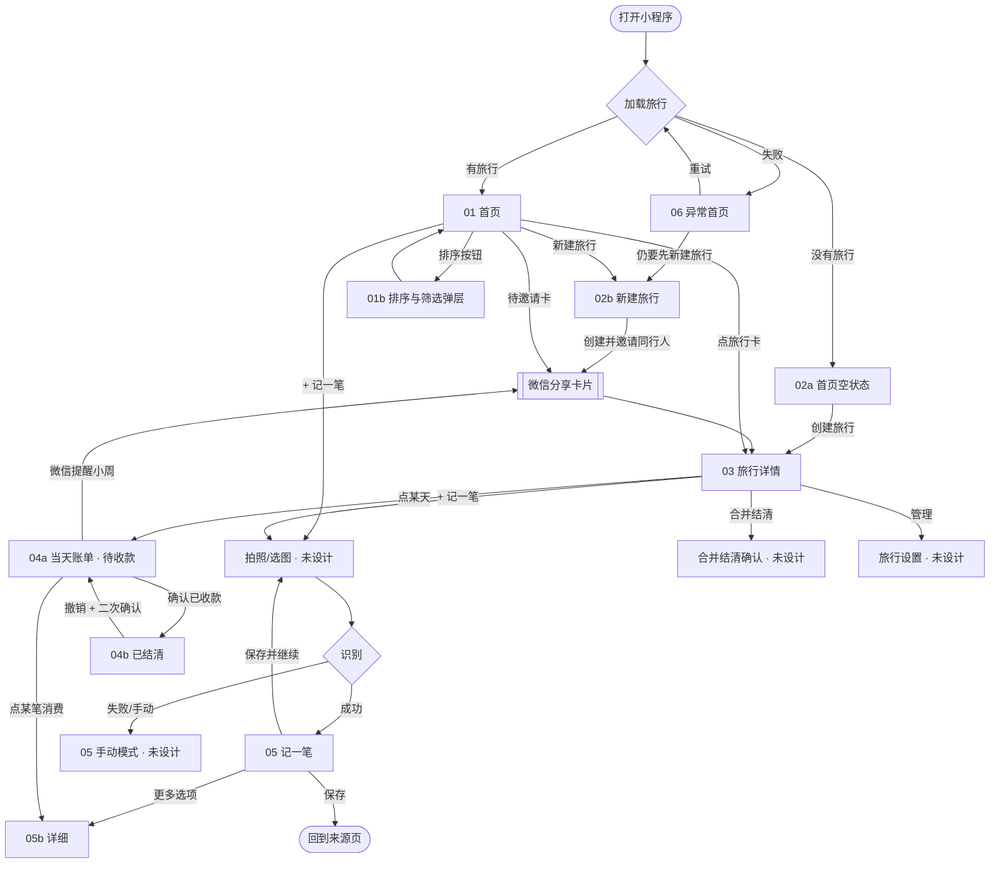
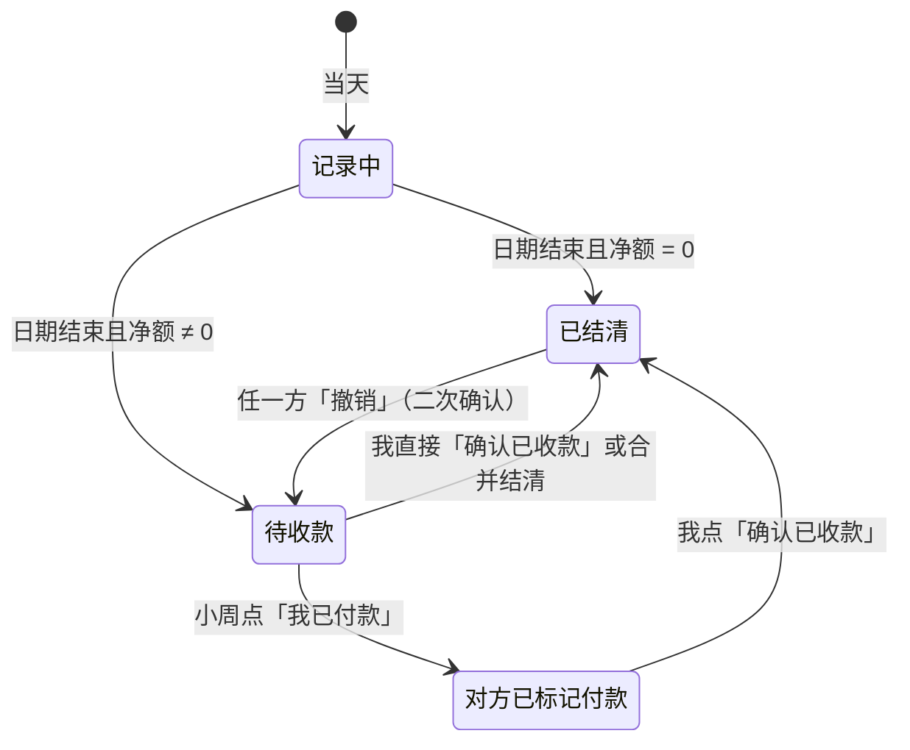

# 05 · 页面流转与状态

## 页面跳转



## 「某一天」的状态机（查看者 = 收款方）



付款方视角对称：待收款 ↔ 待付款，「确认已收款」↔「我已付款」（未设计，见 06）。

## 数据模型（建议）

```ts
Trip     { id: uuid, name, startDate?, endDate?, settleCurrency: 'CNY', members: Member[2], createdAt }
Member   { id, nickname, avatarChar, isMe }
Expense  { id: uuid, tripId, date, storeName, currency: 'JPY', amountMinor: int,   // 外币最小单位整数
           rate: decimal, actualChargeCny?: decimal, payerId,
           splitMode: 'equal' | 'items' | 'custom',
           items?: Item[], customShares?: {memberId, amountMinor}[],
           adjustments?: Adjustment[], receiptImage?, ocrConfidence? }
Item     { name, qty, amountMinor: int, owner: 'equal' | memberId }
DaySettlement { tripId, date, status: 'recording'|'pending'|'payer_marked'|'settled',
                payerMarkedAt?, confirmedAt?, confirmedBy? }
```

派生值（每人份额、当天净额、旅行汇总、首页汇总）都按 `01-business-rules.md` 实时计算，不要存冗余金额。
